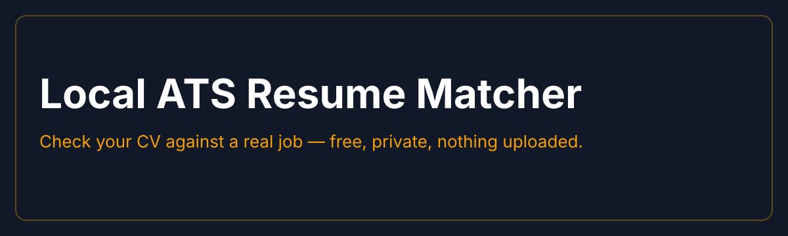

# Local ATS Resume Matcher



[](https://github.com/mrabr381/local-ats-resume-matcher/actions/workflows/ci.yml)
[](https://www.python.org/)
[](LICENSE)
[](#privacy)
[](#quickstart)

**Check your CV against a real job — free, private, nothing uploaded.**
Paste a job description, upload your resume (PDF / DOCX / TXT), and get a
match score out of 100, matched vs missing keywords, and plain-language
fixes — without your resume ever leaving your machine.

> **Live demo:** [mrabr381.github.io/local-ats-resume-matcher](https://mrabr381.github.io/local-ats-resume-matcher/)
> (verified live 2026-11-20) — a real sample report. It is a static
> report; to score your own resume, run it locally below.

## Quickstart

```bash
git clone https://github.com/mrabr381/local-ats-resume-matcher.git && cd local-ats-resume-matcher
python -m venv .venv && source .venv/bin/activate   # Windows: .venv\Scripts\activate
pip install -r requirements.txt
python -m ats_match --resume sample_data/resume.txt --job sample_data/job.txt --out report/
```

Open `report/report.html` in any browser, or run the web app with
`streamlit run app.py` (paste the job, upload the resume, click **Score
my resume**). 1-click deploy: share.streamlit.io → repo
`mrabr381/local-ats-resume-matcher`, branch `main`, file `app.py` →
Deploy (cloud step, not tested by the author). No account. No API key.
No upload. Fully offline after install.

> **spaCy is optional.** Without the `en_core_web_sm` model the tool falls
> back to a built-in regex extractor — same 36/100 on the sample data
> (verified 2026-11-20). Full extractor: `python -m spacy download en_core_web_sm`.

## How scoring works

Everything is computed from the parsed texts — no score is ever hardcoded.
Matching is whole-phrase and case-insensitive, so "java" never matches
"javascript", and a skill is never counted twice.

| Area | Max | What it measures |
|------|----:|------------------|
| Keyword coverage | 50 | Share of job-description keywords found in the resume |
| Skills match | 20 | Share of hard + soft skills named in the job that appear in the resume |
| Experience & education | 15 | Degree (5), years of experience (5), quantified achievements (5) |
| Formatting | 15 | Email (4), phone (3), LinkedIn/URL (2), 3+ sections (4), 1–2 pages (2) |
| **Total** | **100** | |

## Sample result — real job, real score

Sample resume vs the sample job (`sample_data/`), verified 2026-11-20:
**36/100** — keywords 5/101 (2.5/50), skills 1/5 (4.0/20), experience 15.0/15,
formatting 15.0/15. Top fix: add 'forecasting' with evidence.

The low keyword score is honest: a retail analyst's CV genuinely does
not use healthcare data language. The tool discriminates instead of
flattering every resume — apply the fixes and re-run to see it move.

## Comparison with Jobscan

Jobscan (founded 2013) charges **$49.95/month** for the same core scoring
(match score, keyword breakdown, fix suggestions) — but uploads your resume
to their servers, needs an account, and only works online. This tool does
that core job free, locally, offline; it does not do LinkedIn optimisation,
cover letters, or a job-tracking dashboard (Jobscan paid extras).

## Privacy

**100% local.** Parsing, keyword extraction and scoring run on your machine,
with no network calls at runtime (verify it: disconnect and run the CLI).
No account, no API key, no telemetry. The Streamlit app processes uploads
in memory and deletes its temp files immediately.

## CLI usage

```bash
python -m ats_match --resume my-resume.pdf --job job-description.txt --out report/
```

`--resume` PDF/DOCX/TXT, `--job` TXT/MD (both required), `--out` output dir
(default `report/`), `--quiet` prints only the score. Exit codes: `0` =
report written, `1` = input error with a clear message, no traceback.

## Sample data

`sample_data/` holds a realistic **fictional** resume — "Alex Carter",
Junior Data Analyst (PDF, DOCX, TXT) — and a **real** job description
(`job.txt`): a Junior/Intermediate Data Analyst posting from NHS Jobs
(27 November 2025), anonymised (source + notes:
[`sample_data/job.SOURCE.md`](sample_data/job.SOURCE.md)). `sample_output/`
holds the report generated from them. No real person's resume is in this repo.

## Development & testing

```bash
python -m pytest   # tests (scoring maths + sample run)
python -m ats_match --resume sample_data/resume.txt --job sample_data/job.txt --out sample_output/
```

## Limitations

- Keyword matching is lexical (whole-phrase), not semantic: "data viz" won't
  match "data visualisation" — rewording to the job's own terms is exactly
  what the fixes suggest.
- The spaCy `en_core_web_sm` model is small and fast, not the most accurate;
  the curated skills list keeps the important terms precise.
- PDF parsing needs a text-based PDF; scanned-image PDFs are rejected.
- This scores a resume against one job description. It does not write your
  resume, and a high score is not a guarantee of an interview.

## License

MIT — see [LICENSE](LICENSE).
